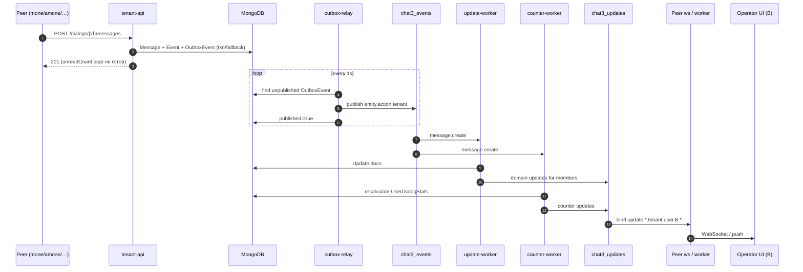
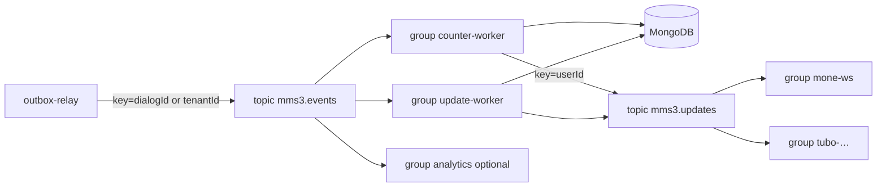
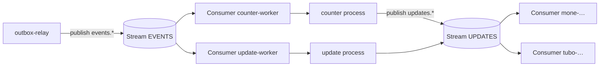
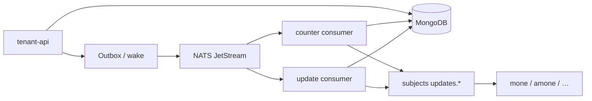
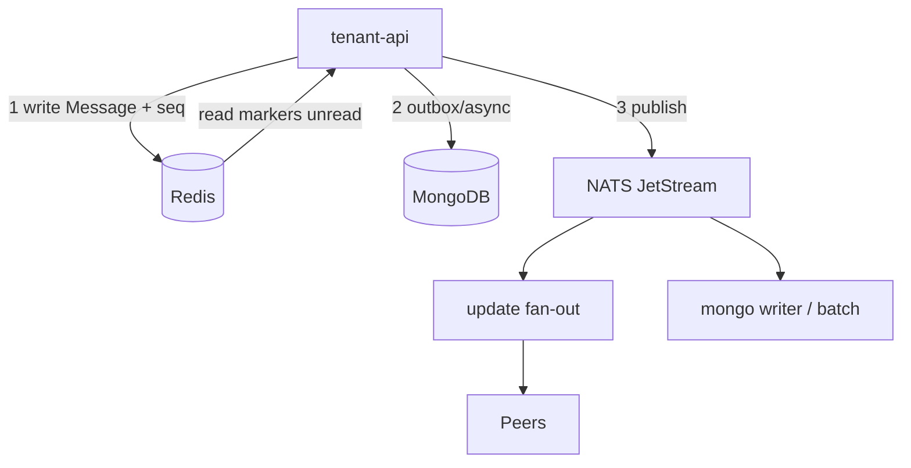

# MMS3 (Chat3): анализ стека и альтернатив (RabbitMQ / MongoDB → NATS / Kafka / др.)

Дата: 2026-11-24  
Статус: исследовательский анализ (не ADR; решений не фиксирует)

## Источники

| Источник | Что взято |
|----------|-----------|
| Этот репозиторий (Chat3 / MMS3) | Код: outbox, workers, RabbitMQ topology, модели; `docs/ARCHITECTURE.md`, EVENTS, UPDATES |
| [antirek/chats-architecture](https://github.com/antirek/chats-architecture) | Разборы OpenIM, Tinode, Chatwoot, Zulip, Rocket.Chat, Synapse, Lets-Chat, Chatto и др. |
| [NATS JetStream docs](https://docs.nats.io/concepts/jetstream) | Streams / consumers / acks |
| [Dendrite Kafka→NATS](https://nats.io/blog/matrix-dendrite-kafka-to-nats/) | Практический кейс компактификации chat-брокера |
| [OpenIM pipeline](https://docs.openim.io/docs/guides/deployment/source) | Kafka + Redis + MongoDB в IM |
| [Chatto ADR-001](https://git.xszz.org/chattocorp/chatto/blob/main/docs/adr/ADR-001-nats-jetstream-as-primary-data-store.md) | NATS JetStream как primary store (event sourcing) |
| Сравнения брокеров (2024–2026) | NATS / Kafka / RabbitMQ / Redis Streams |

---

## 1. Вердикт (кратко)

**MMS3 — не «движок realtime-чата для клиентов», а мультитенантное хранилище диалогов/сообщений + event bus для peer-платформ** (mone, amone, amax, mabo, tubo). Клиентский WebSocket делают peers; MMS3 отдаёт HTTP + RabbitMQ Updates.

Текущий стек **Node.js + MongoDB + RabbitMQ + transactional outbox + 4 workers** корректен и зрелый для гарантий «событие не потеряется», но **тяжёлый по числу процессов и по latency пути A→B**:

```
HTTP write → Mongo (Message+Event+Outbox) → poll 1s → Rabbit events
  → update-worker + counter-worker (prefetch 1) → Mongo Updates/Stats
  → Rabbit updates → peer → UI
```

Типичная нижняя граница задержки realtime после HTTP 201: **~1–3+ с** (poll outbox + два воркера с prefetch 1 + сеть peers), плюс асинхронные unread.

**Если цель — компактнее / быстрее / функциональнее** при сохранении роли «общий chat store + fan-out updates»:

| Цель | Лучший кандидат | Почему |
|------|-----------------|--------|
| Компактнее ops, ниже latency bus | **NATS JetStream** (вместо RabbitMQ) | Один бинарь, subjects ≈ routing keys, durable consumers, replay; Dendrite уже ушёл с Kafka на NATS ради этого |
| Быстрее unread / presence / hot path | **Redis** (+ опционально Streams) рядом с Mongo | Seq/read markers, INCR, pub/sub; паттерн OpenIM |
| Максимальный throughput / долгое хранение event log | **Kafka** | Как OpenIM; для наших объёмов обычно overkill и тяжелее Rabbit |
| Оставить как есть, но упростить | **Оптимизация текущего** | Change Streams / publish-on-commit вместо poll; объединить workers; поднять prefetch |

**Kafka для MMS3 как замена Rabbit — обычно нет.** NATS JetStream или Redis Streams ближе к профилю нагрузки и к желанию «компактнее». MongoDB как SoR (source of truth) для сообщений **оставлять разумно**; менять на Postgres имеет смысл только при жёсткой потребности в SQL/транзакциях между несколькими таблицами и join-тяжёлых отчётах.

---

## 2. Что такое MMS3 сегодня

### 2.1 Роль в платформе

- **Продуктовое имя:** Chat3 (`repo:chat3`, npm workspaces `@chat3/*`).
- **Назначение:** общее мультитенантное API хранилища диалогов, сообщений, packs, topics, meta + доменные Events и персональные Updates.
- **Не делает:** webhook'и мессенджеров, доставку во внешние каналы, ws-server для UI оператора — это peer-проекты.

### 2.2 Компоненты runtime

| Процесс | Тип | Роль |
|---------|-----|------|
| `tenant-api` :3000 | API | REST CRUD; пишет Message + Event + OutboxEvent |
| `controlo-backend` :3001 | API | Init/seed, events/updates browse, DB explorer, recalc/drift |
| `controlo-ui` :3003 | Web | SPA админки |
| `outbox-relay` | Worker | Poll `OutboxEvent` каждые **1000 ms**, publish → `chat3_events` |
| `counter-worker` | Worker | Единственный writer stats; queue `#` на events → `chat3_updates` |
| `update-worker` | Worker | Domain Updates (без stats) → `chat3_updates` |
| `dialog-read-worker` | Worker | Poll `DialogReadTask` (2s), bulk MessageStatus |
| `integrator-grpc-server` | API | gRPC Integrator (отдельный контур) |

Инфра: **MongoDB 7** (`chat3`), **RabbitMQ 3** topic exchanges `chat3_events` / `chat3_updates` (в деплоях часто `mms3_*`).

### 2.3 Ключевые понятия

| Понятие | Смысл |
|---------|--------|
| **Tenant** | Изоляция данных; заголовок `X-Tenant-ID` |
| **Dialog / DialogMember** | Чат и участники |
| **Message / MessageStatus** | Сообщение и статусы (sent/delivered/read) |
| **Pack / Topic / Meta** | Группировки диалогов, топики, произвольные теги |
| **Event** | Доменное событие в Mongo (`message.create`, …); журнал истины изменений |
| **OutboxEvent** | Строка transactional outbox; relay публикует в broker |
| **Update** | Персонализированное уведомление для user/bot/agent; уходит peers по routing key |
| **UserDialogStats / UserStats / PackStats** | Материализованные счётчики (только counter-worker) |
| **ProcessedCounterEvent** | Идемпотентность counter-worker |

### 2.4 Топология RabbitMQ

```
chat3_events  (topic)
  routing: {entityType}.{action}.{tenantId}
  → counter_worker_queue  (#)
  → update_worker_queue   (#)

chat3_updates (topic)
  routing: update.{category}.{userType}.{userId}.{updateType}
  → peer queues (mone ws-server, tubo, …)
```

Peers подписываются wildcards вида `update.*.tnt_acme.user.carl.*`.

### 2.5 Поток сообщения A → B (как есть)



**Важно:** MMS3 не «доставляет сообщение B напрямую». Он сохраняет Message и эмитит Update; peer B решает, как показать это оператору/контакту и нужно ли слать во внешний канал.

### 2.6 Сильные стороны текущего дизайна

1. **Transactional outbox** — нет dual-write «Mongo + Rabbit» из API; события переживают рестарт RMQ.
2. **Разделение Events / Updates** — доменный журнал vs персональный fan-out.
3. **Единый writer stats** — drift-check / full-recalculate в Controlo; предсказуемая модель.
4. **Topic routing** — peers фильтруют по tenant/user без лишнего payload.
5. **Мультитенантность** и богатый REST (filters, packs, meta) — это продукт, не «просто MQ».

### 2.7 Слабые места / цена сложности

| Боль | Деталь |
|------|--------|
| Много процессов | ≥4 workers + API + Controlo + Mongo + RMQ на каждый scoped deploy (mone-mms3, amone-mms3, …) |
| Latency из poll | Outbox poll **1s**; dialog-read **2s** — искусственный floor |
| Prefetch 1 | Counter/update workers сериализуют обработку; при всплесках очередь растёт |
| Дублирование fan-in | Оба worker'а слушают `#` на events; counter фильтрует в коде |
| Двойное хранение событий | Event + OutboxEvent + Update в Mongo **и** сообщения в RMQ |
| Standalone Mongo | Без replica set — fallback без транзакции (warn); теоретическое окно рассинхрона Event/Outbox |
| Ops peers | Все consumers завязаны на AMQP semantics и management UI Rabbit |
| Не realtime engine | Нет встроенного presence/WS; для «быстрого чата end-to-end» путь длинный |

---

## 3. Сравнение с open-source chat-системами

По материалам [chats-architecture](https://github.com/antirek/chats-architecture) и публичным докам. MMS3 ближе к **«chat storage + events для интеграций»**, чем к полному IM (OpenIM/Tinode) или team chat (Zulip/Rocket).

| Система | SoR | Bus / realtime | Модель доставки | Близость к MMS3 |
|---------|-----|----------------|-----------------|-----------------|
| **MMS3 (Chat3)** | MongoDB | RabbitMQ (events→updates) | HTTP write + async Updates к peers | — |
| **OpenIM** | MongoDB + Redis cache | **Kafka** topics (toRedis→toMongo→toPush) | Seq на conversation; WS gateway; batch consumers | Высокая по storage; bus тяжелее |
| **Tinode** | MySQL/Postgres/**Mongo**/… | In-process hub (без Kafka/NATS) | WS/long-poll; topic/subscription | Компактный монолит IM |
| **Chatwoot** | PostgreSQL | Redis (ActionCable + Sidekiq) | Rails API + WS; inbox/conversation | Омниканал support; другой домен |
| **Zulip** | PostgreSQL | **RabbitMQ** → Tornado event queues | Topic-based; per-client event queue | RMQ как у MMS3, но для UI events |
| **Rocket.Chat** | MongoDB | Mongo **Change Streams** + DDP | Write→DB→watcher→notify | Интересный путь без отдельного outbox poll |
| **Synapse (Matrix)** | PostgreSQL | Redis pub/sub + worker HTTP | Event graph / federation | Федерация; другой контракт |
| **Dendrite (Matrix)** | Postgres | **NATS JetStream** (раньше Kafka) | Microservice events | Эталон «компактный bus для chat» |
| **Lets-Chat** | MongoDB | Socket.IO in-process | Простой room chat | Слишком простой |

### 3.1 OpenIM — чему учиться

- Сообщение сразу в MQ → **ack клиенту без ожидания Mongo**; persistence асинхронна (batch).
- **Seq** на conversation + `HasReadSeq` → unread = `maxSeq - readSeq` (дешевле материализованных slice-пересчётов).
- Redis как hot cache; Mongo — cold store.
- Kafka с ключом `conversationId` → порядок в диалоге.

**Для MMS3:** идея seq/read markers и hot Redis ценнее, чем сам Kafka. Текущие `UserDialogStats` можно постепенно заменить/дополнить derived unread.

### 3.2 Zulip — RabbitMQ «как у нас», но другая роль

Django пишет в Postgres, по `on_commit` шлёт event в Rabbit → Tornado держит **per-client event queues**. RMQ — тонкий glue между web и realtime, не dual exchange events/updates с outbox poll.

### 3.3 Rocket.Chat — без классического outbox poll

Write в Mongo → **Change Streams** → notify. Latency ниже poll-модели; цена — зависимость от replica set и семантики change streams (и Meteor-наследие).

### 3.4 Dendrite — прямой ответ на «Kafka vs компактнее»

Команда Matrix ушла с Kafka на **NATS JetStream**: меньше RAM, проще retention, embed в monolith, interest-based cleanup. Для MMS3-масштаба (не миллионы msg/s) это более релевантный прецедент, чем OpenIM-на-Kafka.

### 3.5 Tinode / Chatwoot

- Tinode: один Go-сервер + pluggable DB — максимум компактности, но свой протокол и нет «Tenant API для нескольких CRM-платформ».
- Chatwoot: Postgres+Redis — отличен для support desk; замена MMS3 целиком не подходит (другая модель inbox/agent).

---

## 4. Сравнение брокеров под задачи MMS3

Критерии относительно **реальных обязанностей** MMS3: durable domain events, fan-out персональных updates, worker processing, подписка peers по шаблону ключей.

| Критерий | RabbitMQ (сейчас) | NATS JetStream | Kafka | Redis Streams |
|----------|-------------------|----------------|------|---------------|
| Latency | Средняя | **Очень низкая** | Низкая–средняя | **Очень низкая** |
| Throughput | Достаточный | Высокий | **Очень высокий** | Высокий (память) |
| Routing | Topic exchange + RK (отлично совпадает с updates) | Subjects + wildcards (аналог) | Topics + partitions (грубее) | Один stream / несколько; routing беднее |
| Replay | Слабый (после ack нет) | **Да** (consumer start) | **Да** (offset) | Да (XRANGE) |
| Retention | До потребления / TTL queue | Limits / interest / workqueue | Долгий log | MAXLEN / MINID |
| Ops footprint | Средний (Erlang, management) | **Малый** (1 бинарь, embed) | **Большой** (JVM/KRaft) | Малый, если Redis уже есть |
| Outbox | Нужен (сейчас) | Нужен или CDC; JetStream не заменяет DB txn | То же | То же |
| Peer ecosystem у нас | Уже везде AMQP | Потребует миграции клиентов | Потребует | Потребует |
| Fit для MMS3 | Хороший, но тяжёлый | **Лучший upgrade path** | Overkill для текущего профиля | Отличен как **дополнение** (и как bus для updates) |

### 4.1 Когда Kafka оправдан

Кратко:

- Нужен долгоживущий audit/event log на недели с независимыми replay-потребителями (аналитика, ML, CDC-подобные пайплайны).
- Устойчивый multi-GB/s или жёсткий порядок по partition key на огромных conversation fan-out (OpenIM-класс).
- Уже есть платформенная Kafka в ops.

Иначе: стоимость кластера и операционки не окупается ролью MMS3.

Ниже — почему эти три пункта именно про Kafka, и почему для **текущего** MMS3 они обычно не срабатывают.

#### 4.1.1 Чем Kafka отличается от Rabbit (и от JetStream) по модели

| | **RabbitMQ (сейчас в MMS3)** | **NATS JetStream** | **Kafka** |
|--|------------------------------|--------------------|-----------|
| Ментальная модель | Очередь задач / маршрутизатор | Stream + consumer cursor | **Распределённый commit log** |
| После ack | Сообщение обычно исчезает из очереди | Зависит от retention (interest/limits) | Сообщение **остаётся** в партиции до retention (часы/дни/недели) |
| Cursor | На стороне очереди / unacked | На стороне consumer (сервер NATS) | **Offset** consumer group в логе |
| Независимые читатели одного потока | Отдельные queues + bind (копии) | Несколько durable consumers | Несколько **consumer groups** читают один topic с разных offset |
| Replay «вчерашнего дня» | Практически нет | Да, в пределах retention stream | **Первоклассный** сценарий |
| Порядок | Per-queue (и prefetch) | Per-stream / subject design | **Per-partition** (ключ → партиция) |
| Ops | Средний | Малый | **Тяжёлый** (брокеры, диски, rebalance, мониторинг лагов) |

Ключевой сдвиг: Kafka — не «доставочная очередь для workers», а **долгоживущий лог**, из которого много независимых систем читают и перечитывают историю. Rabbit/JetStream с interest ближе к «доставь и забудь».

#### 4.1.2 Пункт 1: долгоживущий audit / event log + независимый replay

**Задача:** хранить поток фактов (`message.create`, `dialog.member.add`, …) **недели** и дать разным командам читать его независимо:

- аналитика / витрины (ClickHouse, warehouse);
- ML (качество диалогов, боты);
- аудит «что было с диалогом X 10 дней назад»;
- новый сервис подключается и **переигрывает** лог с нуля или с timestamp;
- CDC-подобные пайплайны (не обязательно Debezium — тот же смысл: «лог изменений как продукт»).

В Kafka это естественно:

```
topic mms3.events   retention = 7..30d
  consumer group chat3-counter     offset → …
  consumer group chat3-update      offset → …
  consumer group analytics-etl     offset → …   # может отставать на часы
  consumer group ml-features       offset → …   # может переиграть неделю
```

В **текущем MMS3**:

- журнал фактов уже есть в **Mongo `Event`** (+ Outbox);
- Rabbit держит сообщение только пока workers/peers не ack'нули (плюс TTL на update-очередях);
- «переиграть неделю events из Rabbit» нельзя — их там уже нет;
- для аудита/отладки смотрят Controlo / Mongo, не брокер.

**Когда Kafka оправдан здесь:** Mongo-журнала мало (объём, неудобный full scan, нужны stream-процессоры вроде Flink/ksql, несколько внешних teams читают один bus).  
**Когда нет:** audit закрывает Mongo `Event` + Controlo; внешних replay-потребителей нет; retention в брокере «на всякий случай» = лишний диск и ops.

JetStream с **limits retention на N дней** частично закрывает replay подешевле Kafka; для тяжёлой аналитики Kafka всё же привычнее экосистемой.

#### 4.1.3 Пункт 2: multi-GB/s и порядок по partition key (класс OpenIM)

**OpenIM** использует Kafka не ради «модной очереди», а ради пайплайна:

```
SendMsg → topic toRedis  (key = conversationId)
       → Redis cache + seq
       → topic toMongo / toPush
```

Свойства, которые им нужны:

1. **Ключ партиции = conversationId** → все сообщения одного диалога строго упорядочены в одной partition (seq allocation, batch по комнате).
2. Высокий fan-in/fan-out: accept → cache → persist → push как **отдельные стадии** с буфером между ними.
3. Горизонтальное масштабирование consumers по числу partitions.

В MMS3 порядок сегодня обеспечивается иначе:

- SoR и порядок ленты — в **Mongo** (и бизнес-логика API);
- workers: prefetch 1, идемпотентность `ProcessedCounterEvent`;
- нет отдельного «миллион msg/s accept path», где HTTP только кидает в лог, а persist асинхронно пачками.

**Когда Kafka оправдан здесь:**

- целевая нагрузка ближе к крупному IM (устойчиво высокие msg/s, много online WS, batch pipeline);
- нужен жёсткий total order **внутри диалога на всём async-пайплайне** через bus (не только в БД);
- готовы проектировать topics/partitions/keys и жить с rebalance.

**Когда нет:** нагрузка peer-платформ (mone/amone/…) и scoped MMS3-деплои — это не OpenIM-scale; порядок в диалоге достаточно держать в Mongo; усложнение partition-ключей не ускорит Tenant API.

Грубая шкала (ориентир, не бенчмарк):

| Нагрузка | Типичный bus |
|----------|----------------|
| Сотни–тысячи msg/s, несколько workers | Rabbit / NATS |
| Десятки–сотни тысяч msg/s, много стадий, долгий log | Kafka |
| «Хотим как OpenIM» без измерения своей нагрузки | Часто premature |

#### 4.1.4 Пункт 3: «уже есть платформенная Kafka»

Даже если п.1–2 слабые, Kafka может быть рационален **организационно**:

- SRE уже крутит кластер, мониторинг consumer lag, ACL, MirrorMaker;
- другие продукты пишут в те же topics;
- MMS3 становится ещё одним producer/consumer — **маржинальная** стоимость низкая.

Обратное: вводить Kafka **только ради MMS3** на каждом app46/app55 scoped-стеке = новый тяжёлый dependency рядом с Mongo+Rabbit, хуже компактности, ради которой обычно смотрят на NATS.

#### 4.1.5 Как выглядел бы MMS3 «на Kafka» (если всё же)



Сходство с сегодняшним дизайном:

- outbox в Mongo остаётся (Kafka тоже не даёт txn с Mongo);
- два worker group ≈ две очереди;
- updates — отдельный topic для peers.

Отличия:

- routing wildcards Rabbit (`update.*.user.carl.*`) **нет** — фильтрация через ключ/партиции, headers, или «peer читает шире и фильтрует»;
- персональный fan-out «одна очередь на user» в Kafka делают иначе (много partitions + key=userId, или компактируемые topics, или всё же оставляют push через отдельный слой);
- ops: лаг consumer group, rebalance при деплое workers, диск под retention.

Именно слабая замена **topic-exchange wildcards** для `chat3_updates` — частый аргумент **против** Kafka как drop-in для MMS3 peers (здесь Rabbit/NATS subjects удобнее).

#### 4.1.6 Стоимость, которую «не окупает роль MMS3»

| Статья | Rabbit / NATS | Kafka |
|--------|---------------|-------|
| Память/CPU на стенд | Умеренно / мало | Заметно выше |
| Диск | Малый (очереди короткие) | Большой при retention днями |
| Операции | UI очередей / NATS CLI | Партиции, ISR/KRaft, rebalance, lag alerts |
| Локальный dev | docker один брокер | Тяжелее; часто Testcontainers/Redpanda |
| Миграция peers | — | Все AMQP-клиенты → Kafka clients |
| Компактность scoped MMS3 | Уже натянута | Ещё хуже |

Dendrite ушёл **с Kafka на NATS** как раз потому, что для chat-microservice event bus Kafka «не масштабировалась вниз» (тяжёлая для small/embed, сложный retention). MMS3 по профилю ближе к Dendrite/Zulip-glue, чем к OpenIM data-plane.

#### 4.1.7 Практическое правило для Mobilon

| Ситуация | Вывод |
|----------|--------|
| Ускорить Updates / упростить деплой MMS3 | Не Kafka → §5.A или NATS (§4.2) |
| Нужен долгий shared event stream для аналитики/ML | Kafka (или отдельный export из Mongo `Event` в warehouse **без** замены hot bus) |
| Строим IM-pipeline уровня OpenIM | Kafka (+ Redis) как data-plane; это уже другой продукт |
| Kafka уже в платформе | Можно писать **копию** events в Kafka для ETL, оставив Rabbit/NATS для hot path |
| Заменить Rabbit на Kafka 1:1 | Обычно плохая сделка: теряем удобный routing updates, выигрываем ops-сложность |

**Итог §4.1:** Kafka оправдан как **платформа долгого лога и тяжёлого stream processing**, не как более правильная очередь для Tenant API. Для роли MMS3 «Mongo SoR + короткий durable bus к workers/peers» Kafka почти всегда overkill; разумный компромисс при появлении аналитики — **dual publish / CDC из Mongo в Kafka**, не миграция hot path.

### 4.2 Когда NATS JetStream оправдан

Кратко:

- Хотим **тот же** pub/sub + durable consumers, что даёт Rabbit, но компактнее.
- Subjects: `events.{entity}.{action}.{tenant}`, `updates.{category}.{userType}.{userId}.{type}`.
- Durable consumers вместо именованных queues `counter_worker_queue` / `update_worker_queue`.
- Interest retention: событие уходит, когда все consumers ack'нули (как у Dendrite).
- Опционально Core NATS для typing/presence (ephemeral), JetStream — для durable domain.

Ниже — развёртка на языке текущего MMS3. **NATS не обязателен** (см. вердикт §1); этот раздел описывает, *что именно* даёт замена bus, если её делать.

#### 4.2.1 Что меняется по сути

Сейчас два слоя на Rabbit. Семантика для peers та же («событие домена» и «персональный update»); меняется транспорт и то, кто хранит cursor.

| Сейчас (Rabbit) | Аналог в NATS |
|-----------------|---------------|
| Exchange `chat3_events` + routing key `message.create.tnt_x` | Subject `events.message.create.tnt_x` |
| Очереди `counter_worker_queue` / `update_worker_queue`, bind `#` | **Durable consumers** на stream `EVENTS` |
| Exchange `chat3_updates` + `update.dialog.user.carl.…` | Subject `updates.dialog.user.carl.…` |
| Peer queues с bind wildcard | Подписка на `updates.*.tnt_x.user.carl.>` или durable consumer на stream `UPDATES` |
| Сообщение в очереди, пока не ack → потом обычно удаляется | **Retention policy** на stream (§4.2.4) |

#### 4.2.2 Subjects вместо exchange + routing key

В Rabbit: publish в exchange, ключ маршрутизации отдельно.  
В NATS: **subject = и адрес, и ключ**.

Пример зеркала текущих ключей:

```
events.message.create.tnt_default
events.dialog.member.add.tnt_acme
updates.dialog.user.carl.dialogupdate
updates.user.user.carl.userstatsupdate
```

Wildcards (как `*` / `#` в Rabbit topic):

| NATS | Смысл | Аналог Rabbit |
|------|--------|----------------|
| `*` | один сегмент | `*` |
| `>` | хвост любой длины | `#` |

Примеры подписок:

- counter-worker: `events.>` (всё, фильтр типов в коде — как сейчас);
- или filter на stream: `events.message.>` + `events.dialog.>`;
- peer для carl: `updates.*.*.carl.>` (если сегменты `updates.{category}.{userType}.{userId}.{type}`).

Зачем это компактнее: не нужно отдельно assert exchange, bind queue, править bindings в management UI. Stream один раз с subject `events.>` — всё, что publish'ится на matching subjects, попадает в лог.

#### 4.2.3 Durable consumers вместо именованных queues

**Сейчас:** `counter_worker_queue` — физическая очередь; Rabbit помнит unacked. Два процесса counter-worker конкурируют за одну очередь (competing consumers). То же для `update_worker_queue`. Оба queue bound на `#` к `chat3_events` → fan-out копий в две очереди.

**В JetStream:**

1. **Stream** `EVENTS` — append-only лог с subjects `events.>`.
2. **Consumer** `counter-worker` — именованный курсор: «обработано до seq N».
3. Несколько инстансов с одним consumer name = **queue group** (деление работы, общий cursor).
4. Отдельный consumer `update-worker` — **второй независимый курсор** по тому же stream.

Отличия от Rabbit:

- не обязательно копировать каждое сообщение в две очереди заранее — один stream, два consumer со своими позициями;
- после рестарта worker не обязан помнить offset — **сервер NATS хранит ack floor**;
- короткий replay: новый/отставший consumer можно поднять с прошлого sequence (в пределах retention).



**Outbox в Mongo оставляем:** JetStream не заменяет transactional outbox. Двойная запись API→Mongo и API→NATS по-прежнему опасна. Relay: Mongo `OutboxEvent` → publish в NATS (как сейчас в Rabbit).

#### 4.2.4 Interest retention (как у Dendrite)

Политика stream — **когда** сообщение можно стереть с диска:

| Policy | Поведение | Когда уместно |
|--------|-----------|----------------|
| **Limits** | Хранить N сообщений / M байт / T времени | Короткий event log «на сутки для отладки» |
| **Interest** | Удалить, когда **все** durable consumers, которым сообщение интересно, его ack'нули | Work/event bus между сервисами (Dendrite) |
| **WorkQueue** | После ack одного consumer можно удалить; обычно один логический consumer | Классическая job queue |

**Interest** для MMS3 `EVENTS`:

- counter и update ещё не ack'нули `message.create` → сообщение в stream живо;
- оба ack'нули → NATS может удалить (если больше нет interest);
- не копите бесконечный лог «на годы» внутри брокера;
- пока кто-то отстаёт — данные доставки не пропадают.

Это ближе к смыслу текущих Rabbit queues («держи, пока worker не ack»), чем к Kafka («держи дни по retention независимо от consumers»).

**Interest ≠ история чата.** История — в Mongo (SoR). Stream — буфер доставки и короткий replay для workers/peers.

Для `UPDATES` типично:

- interest или workqueue + TTL (аналог нынешнего `x-message-ttl` ~1 час на peer queue),  
  либо limits «последние N часов», чтобы peer после рестарта чуть догнал, а полный catch-up — из Mongo/API.

#### 4.2.5 Core NATS vs JetStream

Один NATS-сервер закрывает оба режима:

| | **Core NATS** | **JetStream** |
|--|---------------|---------------|
| Persist | Нет (никто не слушал → сообщение исчезло) | Да |
| Typing / presence | Идеально: `typing.dlg_x`, `presence.tnt.user.carl` | Избыточно |
| `message.create` / Updates для peers | Рискованно (peer offline → потеря) | Нужен |
| Latency | Микросекунды–низкие ms | Чуть выше Core, всё ещё низкая |

В MMS3 typing уже лёгкий (короткий TTL на API). Его можно слать в **Core** без outbox и без stream — fire-and-forget. Доменные Events/Updates — только **JetStream**, иначе offline peer/worker потеряет факт (сейчас это роль durable queue + outbox).

```
Core:     typing.>, presence.>          — эфемерно
JetStream stream EVENTS:  events.>      — durable + interest
JetStream stream UPDATES: updates.>     — durable + TTL/interest
```

Сейчас typing может идти тем же тяжёлым Rabbit-путём. Разделение Core/JS — «функциональнее и легче» без второго брокера.

#### 4.2.6 Путь сообщения: сегодня vs JetStream

**Сегодня:**

```
API → Mongo (Message+Event+Outbox)
→ poll relay → Rabbit chat3_events
→ counter_queue + update_queue
→ Mongo stats/Updates → Rabbit chat3_updates → peer queue
```

**С JetStream (та же логика, другой bus):**

```
API → Mongo (Message+Event+Outbox)          # SoR не трогаем
→ relay → NATS events.message.create.tnt
→ stream EVENTS → durable consumers counter / update
→ Mongo … → NATS updates.dialog.user.B.messageupdate
→ stream UPDATES → peer durable consumer / subscribe
→ peer WS → UI
```

Выигрыш не в новой бизнес-логике, а в: один лёгкий бинарь вместо Rabbit; subjects ≈ RK без exchanges/bindings; server-side cursors + interest cleanup; дешёвый ephemeral канал для typing рядом.

**Цена:** абстракция `@chat3/utils` (amqplib → NATS client); миграция peer-подписок (mone/amone/…); ops учит streams/consumers вместо queues/bindings.

#### 4.2.7 Когда из §4.2 реально браться за миграцию

Имеет смысл, если одновременно:

1. Нужен **тот же** паттерн (events → workers → updates → peers), не event-sourcing à la Chatto.
2. Болит **ops/footprint** Rabbit на каждом scoped MMS3 (mone-mms3, amone-mms3, …).
3. Нужен **короткий replay** / проще отладка отставшего worker.
4. Готовы мигрировать peer-подписки (или ввести Update Transport abstraction — §8).

Не оправдано, если цель только «ускорить чат на десятки ms» — сначала дешевле ужать outbox poll и prefetch (§5.A); NATS сам по себе не уберёт Mongo round-trips и работу counter-worker.

### 4.3 Когда Redis Streams / Redis pub/sub оправдан

- **Pub/sub** — мгновенный fan-out updates к peer ws-серверам (at-most-once + catch-up по seq из Mongo).
- **Streams** — лёгкий durable log для workers без второго брокера, если Redis уже в платформе.
- **INCR / hashes** — seq, unread, presence (паттерн OpenIM).
- Риск: память, persistence-настройки, не путать SoR сообщений (оставить Mongo).

### 4.4 Можно ли «убрать брокер»?

Варианты без внешнего MQ:

1. **Mongo Change Streams** (как Rocket) → workers/peers слушают oplog-подобные события.  
   Плюс: меньше компонентов. Минус: жёсткая связь с replica set; сложнее независимый fan-out нескольким peers; peers должны уметь resume token.
2. **Postgres LISTEN/NOTIFY** — только если уйти с Mongo; лимит payload ~8KB.
3. **In-process** (Tinode) — ломает текущую multi-deploy / multi-peer модель.

Для нескольких peer-стеков (mone/amone/…) отдельный bus **остаётся желательным**.

---

## 5. Сценарии эволюции (от малого к большому)

### A. Быстрые улучшения без смены брокера (низкий риск)

1. **Снизить OUTBOX poll** (200–300 ms) или заменить poll на **change stream / wake channel**.
2. **Publish after commit + outbox как safety net** (hybrid): быстрый путь + гарантированный догон.
3. Поднять **prefetch** у update-worker; для counter — шардирование по `tenantId`/`dialogId`.
4. Объединить update+counter в один процесс с двумя pipeline (меньше контейнеров).
5. Derived unread: хранить `lastMsgSeq` / `readSeq` → меньше тяжёлых `recalculateSlice`.

Ожидание: latency A→Update **вниз в сотни ms**, ops чуть проще; контракт peers не меняется.

### B. Замена RabbitMQ → NATS JetStream (средний риск, лучший «компактнее»)



Шаги:

1. Абстракция `@chat3/utils` pub/sub (сейчас жёстко amqplib).
2. Dual-publish или dual-consume на переходный период.
3. Переписать peer-подписки (mone ws и др.) на NATS clients.
4. Выключить Rabbit в scoped MMS3-деплоях.

Выигрыш: меньше RAM/CPU брокера, проще embed/dev, replay для отладки Controlo, subjects ≈ текущим RK.  
Цена: миграция всех peers; обучение ops; потеря привычного Rabbit Management (замена — NATS monitoring).

### C. OpenIM-like hot path: Mongo + Redis + (NATS|Kafka) (высокий выигрыш по скорости)



- Seq + read markers → unread без тяжёлого counter-worker на каждый message.create.
- Typing/presence — Core NATS или Redis pub/sub.
- Counter-worker остаётся для pack/aggregate stats или ужимается.

Выигрыш: realtime-профиль ближе к IM.  
Цена: ещё один stateful компонент; консистентность Redis↔Mongo; больше кода.

### D. Kafka как у OpenIM (обычно не рекомендуем для MMS3)

Имеет смысл только при явном росте: десятки тысяч msg/s, долгий shared event log для многих аналитических consumers, уже существующая Kafka-платформа. Иначе ops-регресс относительно Rabbit/NATS.

### E. Смена SoR Mongo → Postgres

Имеет смысл при: жёстких relational отчётах, желании LISTEN/NOTIFY + outbox в одной БД, командной экспертизе SQL.  
Не даёт само по себе «быстрее чат»; миграция моделей/мета/packs дорогая. **OpenIM и Rocket успешно живут на Mongo** — Mongo не является корнем проблем MMS3.

---

## 6. Матрица «цель → стек»

| Цель | Рекомендация |
|------|----------------|
| Компактнее деплой MMS3 | NATS JetStream (+ опционально merge workers); рассмотреть embed NATS в Controlo/dev |
| Быстрее Updates до peer | Убрать/сократить outbox poll; NATS или Redis pub/sub на hot path |
| Функциональнее (IM-фичи: seq sync, multi-device catch-up) | Redis seq/read + replay из JetStream/Mongo; API resume-by-seq |
| Надёжнее stats | Оставить идемпотентный writer; derived unread; drift-check сохранить |
| Аналитика / долгий event log | Kafka **или** JetStream file store с длинным retention — отдельно от hot updates |
| Заменить всё готовым OpenIM/Tinode | **Не стоит** как drop-in: другая модель (WS-first IM), нет Tenant API/packs/meta под mone/tubo; интеграционный rewrite дороже эволюции Chat3 |

---

## 7. Рекомендуемая траектория для Mobilon

Практичный путь без big-bang:

### Фаза 0 — измерить

- Метрики: p50/p95 времени `OutboxEvent.createdAt → published`, `→ Update в chat3_updates`, размер очередей workers, drift counters.
- Нагрузка: msg/s на mone-prod / amone / amax scoped MMS3.

### Фаза 1 — ускорить текущий контур (1–2 итерации)

- Outbox wake / меньший poll; prefetch; optional merge workers.
- Прототип derived unread на одном типе событий рядом со stats.

### Фаза 2 — bus abstraction + NATS JetStream на одном scoped стенде (например mone-red-mms3)

- Сохранить Mongo + outbox.
- Subjects зеркалят routing keys.
- Один peer (mone) перевести на NATS; сравнить latency/ops.

### Фаза 3 — Redis hot path (если Фаза 2 недостаточно)

- Seq/read markers, presence/typing.
- Counter-worker только для сложных pack/aggregate кейсов.

### Не делать без явного драйвера

- Переписывать MMS3 на Kafka «потому что OpenIM».
- Менять Mongo на Postgres «для скорости».
- Подменять Chat3 целиком OpenIM/Chatwoot.

---

## 8. Соответствие текущим контрактам peers

Любая смена брокера затрагивает:

- `MMS3_API_URL` / Tenant API — можно не трогать.
- AMQP URL, exchanges `mms3_events` / `mms3_updates` (или `chat3_*`) — **контракт mone/amone/amax/mabo/tubo**.
- Формат Update payload и routing key сегменты — лучше сохранить семантику при смене транспорта.

Имеет смысл ввести тонкий **Update Transport** в peer-коде (AMQP | NATS | Redis), чтобы MMS3 мог мигрировать поэтапно.

---

## 9. Глоссарий альтернатив (коротко)

| Технология | Одной фразой |
|------------|----------------|
| **RabbitMQ** | Классический брокер с богатой маршрутизацией; сейчас в MMS3 и Zulip |
| **NATS Core** | Эфемерный pub/sub сверхнизкой latency |
| **NATS JetStream** | Persistent streams + durable consumers поверх NATS |
| **Kafka** | Распределённый commit log; replay и высокий throughput |
| **Redis Streams** | Append-only log в Redis с consumer groups |
| **Transactional Outbox** | Пишем событие в БД атомарно с бизнесом, relay публикует в bus |
| **Change Streams** | Подписка на изменения Mongo; альтернатива poll outbox |
| **Seq / read marker** | Порядок и unread через номера, без тяжёлых агрегатов |

---

## 10. Итог

MMS3 уже правильно разделён на **SoR (Mongo)** и **delivery bus (Rabbit)** с outbox — это солидная база. Узкие места не в «Mongo плох» и не в «нужен Kafka», а в:

1. **poll-latency и число процессов** вокруг Rabbit;
2. **материализованные счётчики** вместо seq-модели;
3. **отсутствие hot-layer** для presence/unread.

Наиболее осмысленный апгрейд для целей «компактнее / быстрее / функциональнее»:

**MongoDB (SoR) + NATS JetStream (bus) + опционально Redis (seq/unread/presence)**,  
с эволюцией peers через абстракцию транспорта и сохранением Tenant API / Updates-семантики.

Kafka — инструмент для OpenIM-масштаба и долгого shared log; для текущего MMS3 это, как правило, шаг в сторону большего ops без выигрыша по продукту.
